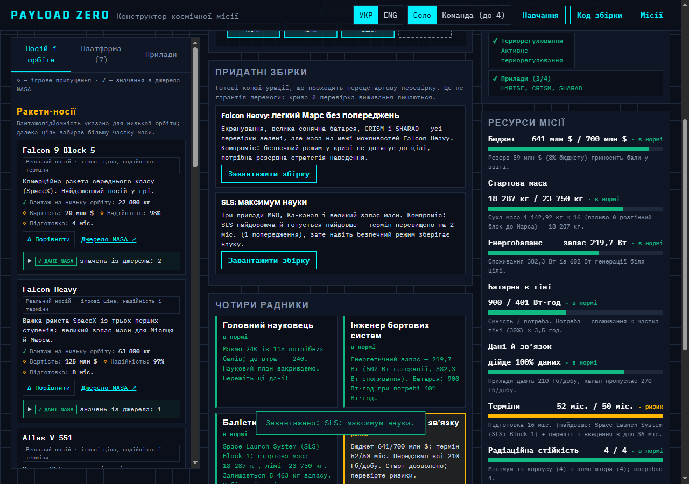

# PAYLOAD ZERO

A browser game for the **NASA Space Apps Challenge 2026 — “Space Mission Design Game”**. Players design a complete science mission from concept to operations: choose a mission goal, a launch vehicle and orbit, fill seven spacecraft subsystems, pick up to four NASA instruments, pass a pre-launch review, fly three mission phases, survive a crisis and read a post-flight analysis that explains *why* the mission succeeded or failed.

The whole game is available in **Ukrainian and English** (УКР / ENG switch on every screen) and supports **solo play or a local team of up to four people on one device**.

- Static site, plain JavaScript (classic `<script>` tags, global `window.Engine`), no framework, no backend, no runtime dependencies.
- Works from `file://` or any static host such as GitHub Pages.
- Every number shown is labelled as either **✓ NASA-sourced** or **◇ game assumption**.



## Contents

1. [Run the game](#run-the-game)
2. [How to play](#how-to-play)
3. [Game model and rules](#game-model-and-rules)
4. [Balance changes and their rationale](#balance-changes-and-their-rationale)
5. [Localization (uk / en)](#localization-uk--en)
6. [Team mode](#team-mode)
7. [Architecture and Engine API](#architecture-and-engine-api)
8. [Tests and checks](#tests-and-checks)
9. [NASA data and resources](#nasa-data-and-resources)
10. [Model limits — what this game is not](#model-limits--what-this-game-is-not)
11. [AI usage disclosure](#ai-usage-disclosure)

## Run the game

**Option 1, no tools needed.** Open `index.html` in a current browser (Chrome, Edge, Firefox or Safari).

**Option 2, local server** (Node.js 18+):

```bash
node tests/serve.js 8080
# then open http://127.0.0.1:8080/
```

**GitHub Pages (instructions only; nothing has been published).** Push the repository and enable *Settings → Pages → Deploy from a branch → `main` / root*. No build step is required. The `tests/` and `docs/` folders are harmless on Pages.

Google Fonts are optional. Without network access the game falls back to system fonts and stays fully playable; an automated check covers this.

## How to play

1. **Briefing.** Pick a mission. Landsat 9 (Earth) is marked *Easy* and recommended for beginners. LRO (Moon) is *Medium* and MRO (Mars) is *Hard*. A 6-step tutorial opens on the first visit and is always available from the header.
2. **Launcher & orbit.** The mission requires one specific orbit. The launcher must lift the *launch mass*: dry mass × a transfer factor for the target.
3. **Bus (7 subsystems).** Structure, power generation, battery, communications, flight computer, propulsion and thermal control. An empty slot blocks launch.
4. **Instruments (1–4).** Each one adds science but costs mass, power, money, lead time and downlink capacity. An instrument built for another target earns 0 points.
5. **Pre-launch check.** The right-hand column lists the required slots, eight resource gauges (budget, launch mass, power balance, eclipse battery, data & comms, schedule, radiation hardness, science), the four advisors and the check itself:
   - **Errors** (red) block launch: empty slot, no launcher, wrong orbit, over budget, over mass.
   - **Warnings** (amber) allow launch after one confirmation, but each multiplies the survival chance by 0.95.
   - **Preview (Δ)** on any catalog card shows the before/after diff for a part swap: budget, mass, power, battery, data, time, effective science, radiation, plus new and resolved issues. It never changes the build.
6. **Flight.** Three phases run with their real status (SUCCESS / WARNING) and logs. A crisis follows: choose an option (each shows the *actual* survival chance and the science you would keep) and confirm. Phase 4, the downlink, follows, then the report.
7. **Report.** Status, score, rank, the science path (instruments → comms → power → crisis → final, with the engine’s rounding), where the score and rank come from, whether the outcome was design or luck, concrete advice, the NASA sources used and the blueprint code. **New flight** re-flies the same build with a new crisis roll; **Modify spacecraft** returns to the builder.

**Presets.** Each mission has two launch-ready builds with an explanation of their trade-offs (e.g. “Falcon Heavy, lean, no warnings” vs “SLS, maximum science, 2 months late”). They are valid builds, not a guaranteed win.

**Save & share.** The `PZ|1|…` blueprint code can be copied in the builder, in the *Blueprint code* dialog and in the report. One code works in both languages. A draft is autosaved in `localStorage`; after a reload the game *offers* to restore it and never overwrites work silently. Restore and import run the same validation; an invalid code never changes the build.

## Game model and rules

All formulas are in `engine.js` (`calculateTelemetry`, `checkCompatibility`, `resolveCrisis`). This pass did not change them; balance was done through game data only.

| Resource | Formula (game model) |
| --- | --- |
| Budget | launcher cost + sum of part and instrument costs (million USD, game values) |
| Launch mass | `round(dry mass × transfer)`, where transfer = Earth 3, Moon 7.5, Mars 16 |
| Mass limit | `round(launcher LEO capacity × orbit payload fraction)` |
| Power | generation = array W × mission solar factor (Mars 0.43); deficit → science × 0.6 |
| Battery | need = power draw × eclipse fraction × 3.5 h |
| Data | link = comms rate × contact hours/day; delivered share = min(1, link / generated) |
| Schedule | slowest lead time of all parts, instruments **and launcher** + transit/commissioning (Earth 18, Moon 24, Mars 36 months) |
| Radiation | min(structure, computer) hardness vs mission level |
| Science | `effective = round(compatible points × delivered share × power factor)` |

**Crisis and survival.** `survival = option chance × launcher reliability × 0.95^warnings`. One `Math.random()` roll decides survival. If the spacecraft survives, `final science = round(effective × option science factor)`; otherwise it is 0.

**Score.** `70 × min(1.25, final / goal) + 15 × budget reserve + 15 × schedule reserve`. FAILED gives 0 / F; PARTIAL (survived below the goal) is capped at 79. Rank: S ≥ 90, A ≥ 80, B ≥ 65, otherwise C.

**Honest randomness.** The game never fixes rolls. Re-rendering, switching language or re-reading the report never calls `Math.random()` again. Tests control randomness by replacing `Math.random` inside the test harness only.

## Balance changes and their rationale

An exhaustive audit (`npm run audit:balance`) evaluates every full build on each mission’s required orbit: 8,064 builds for the Moon and for Mars and 3,456 for Earth. Only fields listed in each entry’s `gameOnlyFields` were changed. NASA `verifiedSpecs`, LEO capacities and source URLs are unchanged; a test checks this with a SHA-256 digest taken from the original commit.

| Problem found | Change |
| --- | --- |
| No structure had radiation hardness 4: the shielded lunar crisis option was always locked, and the Mars radiation warning could never be cleared | Added **`ch_shielded`**, a game component (hardness 4, heavier, pricier, 13-month lead time). It is labelled “Game component” and claims no NASA-verified numbers |
| Only SLS could launch any Mars build | Mars science orbit payload fraction 0.12 → 0.25 (game field). Falcon Heavy now carries lean Mars builds; SLS is for heavy ones |
| The time limit was never binding | Mission limits Moon 48 → 38, Mars 72 → 50, Earth 48 → 30 months. Lead times now differ by part (3–14 months), and launchers got a game lead time (Falcon 9 4, Atlas V 5, Falcon Heavy 8, SLS 16) |
| Atlas V cost more and lifted less than Falcon 9 at the same reliability | Atlas V game cost 125 → 110, game reliability 0.98 → 0.995: the most reliable launcher. Historical context: LRO, MRO and Landsat 9 all flew on Atlas V 401 |
| The UI showed the base crisis chance, not the one actually applied | Crisis options and the pre-launch check show `option × reliability × 0.95^warnings` |

Audit results after the change (all asserted in `tests/balance.test.js`):

| Mission | Launch-ready builds | With 0 warnings | Can reach the goal | Over schedule | Rockets that can launch |
| --- | --- | --- | --- | --- | --- |
| LRO (Moon) | 2,895 / 8,064 | 331 | 1,543 | 69 | Falcon 9, Falcon Heavy, Atlas V, SLS |
| MRO (Mars) | 3,778 / 8,064 | 8 | 947 | 2,016 | Falcon Heavy, SLS |
| Landsat 9 (Earth) | 2,591 / 3,456 | 96 | 575 | 863 | Falcon 9, Falcon Heavy, Atlas V |

Every crisis option is available in at least one launch-ready build. Locked options always show why they are locked and how to unlock them. Mars remains deliberately the hardest mission: only eight builds avoid every warning, and all of them sit at Falcon Heavy’s mass limit.

## Localization (uk / en)

- `i18n.js` is the core: `I18N.t(key, params)`, `Intl.NumberFormat` (uk-UA / en-US), `Intl.PluralRules` plurals (1 бал / 2 бали / 5 балів / 1,5 бала), dates and language detection. `i18n-dict.js` holds symmetric dictionaries (673 keys per language).
- **Language choice:** saved choice in `localStorage` (`pz.lang`) → otherwise `uk` if the browser’s primary language is Ukrainian → otherwise `en`. A missing `navigator` or blocked storage does not break start-up.
- **Dynamic text is stored as keys plus parameters.** Engine errors and warnings, advisors, phase titles and logs, crisis texts and report insights are rendered in the current language when read. Finished phases and a saved report are therefore re-read in another language without re-simulating or rolling again. The public contract (strings in `errors`, `warnings`, `message`, `logs`, `insights`) is unchanged.
- **NASA catalog text is translated by stable ID and field** (`data.inst.inst_hirise.name`, `spec.payloadToLEOKg`, …). `nasa_data.js` and its `verifiedSpecs` are untouched. Proper names (Falcon 9, Atlas V, SLS) and established abbreviations (LRO, HiRISE, OLI-2) stay as they are, with an explanation in the interface language.
- Switching language changes nothing in the build, mode, flight phase, option availability, roll, chance or score. It works on every screen, inside dialogs and in the open crisis, where it keeps the selection and focus.
- **Missing keys:** in dev/test mode (`?dev=1`, `?i18n=strict`, or `PZ_I18N_STRICT = true`) a missing key or parameter throws. In production it renders a visible `⟦key⟧` marker and is recorded in `I18N.missing`; there is no silent fallback to the other language. Completeness is proven by tests (see below).

To add a string, add the same key to both `uk` and `en` blocks in `i18n-dict.js` and run `npm run test:unit`.

## Team mode

*Team (up to 4)* is a **local, same-device** mode; there is no online multiplayer, lobby or network sync.

- Choose 1–4 players. Four roles are shared round-robin: **Scientist** (science goal, instruments, data), **Systems engineer** (power, battery, radiation, the 7 subsystems), **Flight dynamics** (launcher, orbit, mass) and **Mission / comms director** (budget, schedule, link, final crisis decision). Each role sees its advisor’s status.
- Every player approves the shared build. Any build change resets approvals; a language change does not. Team approval is an extra UI condition: the engine’s `canLaunch` remains the engineering check.
- In the crisis, the dialog becomes a team discussion: each role gets a guiding question, and the director confirms the shared decision.

## Architecture and Engine API

| File | Role |
| --- | --- |
| `index.html` | Static markup with `data-i18n` keys. Script order: `nasa_data.js → i18n.js → i18n-dict.js → engine.js → presets.js → ui.js` |
| `nasa_data.js` | Source dataset (NASA identities + `verifiedSpecs`, game fields in `gameOnlyFields`) |
| `i18n.js`, `i18n-dict.js` | Localization core and uk/en dictionaries |
| `engine.js` | Game model (`window.Engine`), pure and UI-agnostic |
| `presets.js` | Launch-ready preset builds (`PZ_PRESETS`) |
| `ui.js` | Interface, flight runner, dialogs, team mode, drafts |
| `style.css` | Responsive layout (3 / 2 / 1 columns), focus styles, reduced motion |
| `tests/` | Unit, balance, i18n and browser tests, plus a static server and a tiny CDP driver |

The original API is kept: `getMissions, getCatalog, initMission, selectRocket, selectOrbit, selectBusPart, toggleInstrument, calculateTelemetry, checkCompatibility, getAdvisorsFeedback, getState, startSimulation, resolveCrisis, getBlackBoxReport, exportBlueprintCode, importBlueprintCode`. `startSimulation()` still returns the crisis itself; phases are read from `Engine.simulation.phases` (`{ id, title, status, logs }`). Blueprint format `PZ|1|mission|mode|rocket|orbit|7 bus slots|instruments` is unchanged.

Additions (they do not change the contract):

- `resetSimulation()` clears only the flight and returns `getState()`.
- `setMode(mode)` changes the solo/team label only.
- `previewChange({type, id, category})` returns a side-effect-free before/after.
- `evaluateBuild(build)` evaluates any build for the current mission without mutation.
- `validateBlueprintCode(code)` validates exactly like import, without applying.
- `compatibility.issues` gives structured `{ level, code, params }` entries.
- Crisis options carry `effectiveSurvivalChance` and `lockReason`.
- The report carries `analysis` with the science path, survival factors and score parts.
- Thrown errors carry a stable `code` (e.g. `INSTRUMENT_LIMIT`, `CODE_FORMAT`).

## Tests and checks

No packages are installed. Tests use Node built-ins (`node:test`, `vm`, `http`, global `WebSocket`) and a locally installed Chromium-based browser (Edge or Chrome, auto-detected; override with `BROWSER_PATH`). Node 22+ is required for the browser tests.

```bash
npm run check:syntax   # node --check on every script; game scripts must not use import/export
npm run test:unit      # engine, i18n and balance suites (node:test)
npm run test:e2e       # real headless browser via the DevTools protocol; writes docs/screenshots/
npm run audit:balance  # prints the exhaustive balance audit
npm test               # all of the above except the audit
```

Results on 2026-11-14 (Windows 10, Node 26.13.1, Microsoft Edge 157):

- `check:syntax`: 15 files pass.
- `test:unit`: **37 / 37 pass**: 20 engine, 10 i18n, 7 balance.
- `test:e2e`: **32 / 32 pass.** Coverage:
  - regressions from the independent review, each in its own check:
    - launching an unchanged build after Modify (both languages) offers *View the report* or an explicit *New flight*, never the old resolved crisis;
    - an open *Abort the flight?* confirmation pauses the flight, so the crisis never covers it; both the cancel and confirm branches are tested;
    - drafts with a missing, zero or out-of-range `savedAt` (e.g. 1e20) load, switch language and restore;
    - an S-rank report never suggests a “higher rank”;
  - full Ukrainian and English runs of all three missions to the report;
  - PARTIAL and FAILED reports in both languages;
  - strict i18n mode (`?dev=1`) through the tutorial, team panel, previews, flight and report in both languages with no missing key or parameter;
  - a run from `file://`;
  - language switching before a mission, in the builder, in the pre-launch dialog, during phases, in an open crisis and after the report, with build, telemetry, options, roll, chance, score and `Math.random` call count unchanged; language persists after reload;
  - double clicks on launch and on the crisis confirmation;
  - import, mission and mode changes locked during a flight;
  - abort and explicit new flight;
  - launch rules, the fifth instrument and invalid imports;
  - draft restore with corrupted or blocked `localStorage`;
  - preview without mutation, including keyboard use;
  - team approvals;
  - layouts at 360 / 390 / 768 / 1280 / 1440 px: no horizontal scroll, the header never covers the tabs (real mouse click), quick launch bar reachable on narrow screens;
  - keyboard tabs and the crisis focus trap; `prefers-reduced-motion`;
  - play with Google Fonts blocked;
  - zero console errors or uncaught exceptions in every check.

What the language tests prove beyond a Cyrillic search:

- dictionaries have identical key sets, types and placeholders;
- every UI key and every catalog ID has a translation;
- every string value in `verifiedSpecs` has a translation or is a date or proper name;
- English output has no Cyrillic, and Ukrainian output has no English words beyond an allow-list of proper names and abbreviations. This is checked both on the dictionaries and on hundreds of dynamic engine outputs and live DOM text, including `title`, `aria-label` and `placeholder`.

Screenshots of key screens in both languages are in [`docs/screenshots/`](docs/screenshots/).

## NASA data and resources

Mission identities, instruments and `verifiedSpecs` come from these NASA pages (also listed in the game’s report screen for the parts actually used):

- LRO: <https://science.nasa.gov/mission/lro/about/>, <https://science.nasa.gov/mission/lro/spacecraft-and-instruments/>
- MRO: <https://science.nasa.gov/mission/mars-reconnaissance-orbiter/>, <https://science.nasa.gov/mission/mars-reconnaissance-orbiter/science-instruments/>, <https://science.nasa.gov/wp-content/uploads/2024/03/44745_mro-arrival.pdf>
- Landsat 9: <https://science.nasa.gov/mission/landsat-9/>
- Earth orbits: <https://science.nasa.gov/earth/earth-observatory/catalog-of-earth-satellite-orbits/>
- Launch vehicles: <https://ntrs.nasa.gov/api/citations/20240001680/downloads/HU-CAS-Seminar_2024-02-12.pdf>, <https://www.nasa.gov/wp-content/uploads/2024/01/routine-payloads-ea.pdf>, <https://www.nasa.gov/reference/space-launch-system/>
- Subsystem categories (NASA Small Spacecraft Technology State of the Art): <https://www.nasa.gov/smallsat-institute/sst-soa/> and its structures, power, communications and in-space propulsion chapters
- Crisis inspirations: SOHO space-weather resources <https://soho.nascom.nasa.gov/soc/esr/>, the Kepler reaction-wheel news release and the 2023 Voyager 2 communications-pause update (links in `nasa_data.js`)

Challenge resources that shaped the design:

- **Design and Develop Science Missions** (NASA Small Spacecraft Systems Virtual Institute webinar, 2025). Its four mission segments map onto the game: *launch* (launcher, orbit, mass), *space* (bus and instruments), *ground* (contact windows and downlink bottleneck) and *user* (science points and the report). Its “begin with the end in mind” flow is the briefing → requirements → design → verify order.
- **CubeSat 101** (NASA CSLI, 2017). Its ideas of *margin* (reserves earn score; the battery and link need headroom), long lead times and schedule padding (binding schedules), the importance of the ground station (“launching with an inadequate ground station is a mission killer” → comms bottleneck), and review before launch (the pre-launch check) are reflected in the rules and advice texts.

The other Space Apps resources (GMAT, CML, Mission Design Lab, Mission Viz, Webb game) were read as background; the game does not use their data.

## Model limits — what this game is not

- Not orbital mechanics. Transfer factors, payload fractions, solar factors, battery hours, link rates, costs, reliabilities, lead times, science points and crisis odds are **simplified game assumptions**, marked ◇ on screen.
- LEO capacities are real (✓) but are **not** a statement of a launcher’s capability to the Moon or Mars. The game turns them into targets through simple multipliers.
- Bus parts are generic subsystem types with NASA reference links, not specific flight hardware. `ch_shielded` is a game-only component. The “MRO-inspired” array is not MRO hardware.
- Atlas V’s 0.995 and the other reliabilities are game values chosen for trade-offs, not official statistics.
- Crisis scenarios are teaching scenarios inspired by real events, not reconstructions of incidents on these missions.
- Team mode is local only. Online rooms, accounts, leaderboards, 3D, and ground-network or test-campaign choices are out of scope for this stage.

## AI usage disclosure

PAYLOAD ZERO was developed using a collaborative, prompt-driven workflow combining three AI tools, each assigned to specific engineering and documentation tasks:

- **Google Gemini** — used for initial brainstorming, four-screen game architecture planning, mathematical modeling of spacecraft resource trade-offs (transfer mass multipliers, solar efficiency scaling, eclipse battery sizing, and downlink bottlenecks), balance auditing, and structuring project documentation.
- **Claude & Claude Code (Anthropic)** — used to implement and refine the pure JavaScript simulation engine (`engine.js`), bilingual localization layer (`i18n.js`, `i18n-dict.js`), interactive builder and flight runner (`ui.js`), launch-ready presets (`presets.js`), and the zero-dependency Node/Chromium unit, balance, and E2E test suites.
- **ChatGPT (OpenAI)** — used to curate and format NASA reference parameters in `nasa_data.js` (separating `verifiedSpecs` from `gameOnlyFields`), enhance the tactical HUD styling (`style.css`), interactive CAD SVG spacecraft blueprint and terminal animations (`index.html`, `ui.js`), and proofread English presentation and submission materials.
